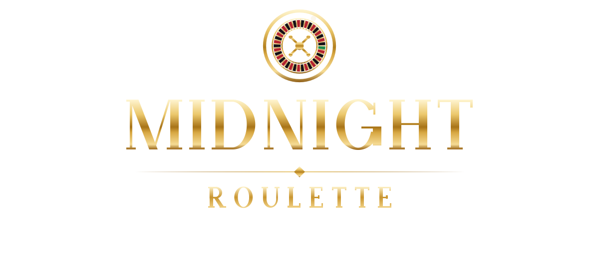
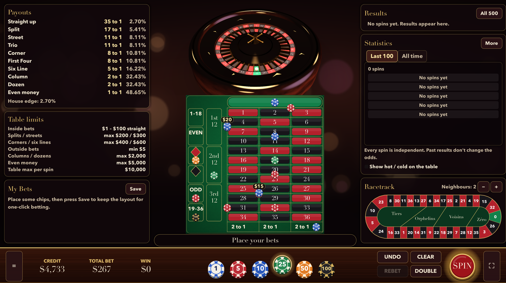
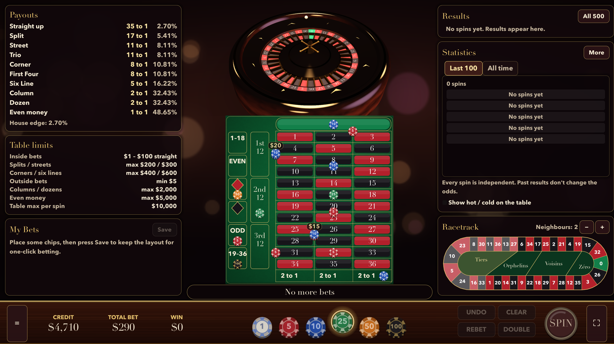
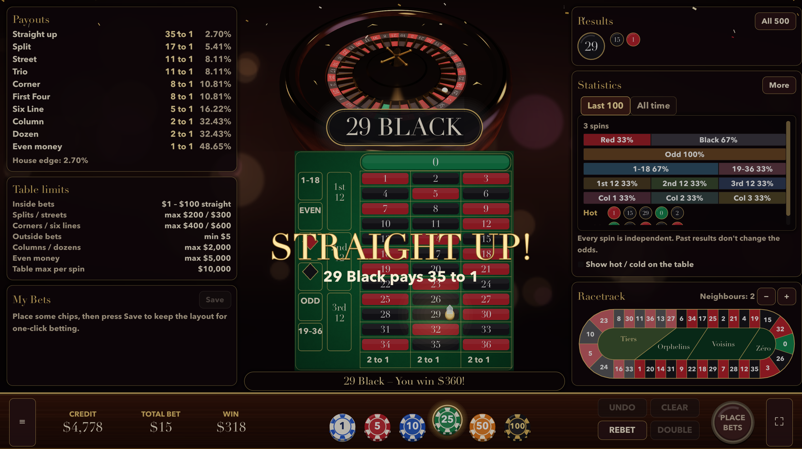
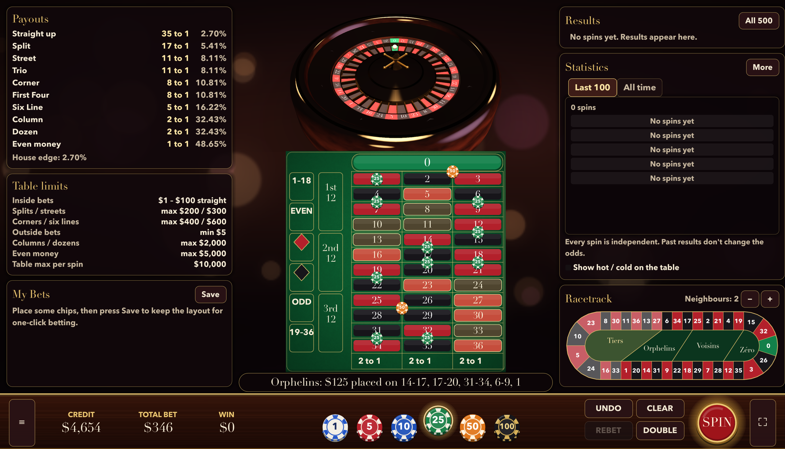

  

<b>An elegant European roulette table for your Mac or PC. Play money only.</b>

## ⬇️ Download

[-c9952f?style=for-the-badge&logo=apple)](https://github.com/MilkshakeSR/MidnightRoulette/releases/latest/download/MidnightRoulette.dmg)
[-7a1f2b?style=for-the-badge&logo=windows)](https://github.com/MilkshakeSR/MidnightRoulette/releases/latest/download/MidnightRoulette-Windows.zip)

Or see every version on the [Releases page](https://github.com/MilkshakeSR/MidnightRoulette/releases).

> **Play money only.** Credits have no cash value and can't be bought or withdrawn. No ads, no purchases, no gambling sites.

## Screenshots

## Features

- **A real European wheel** – single zero, 37 pockets, a smooth 3D wheel with a mahogany bowl, gold frets and turret, and a ball that rolls, drops, hits deflectors and rattles into its pocket. Normal, fast or instant spins.
- **Every bet** – straight ups, splits, streets, trios, corners, First Four, six lines, columns, dozens, red/black, odd/even and 1–18/19–36. Hover any spot to see exactly what it covers and pays.
- **Racetrack call bets** – Voisins du Zéro, Tiers du Cylindre, Orphelins, Jeu Zéro and neighbours.
- **Feels like a table** – chips drop and stack, the dolly marks the winning number, the rake sweeps losing chips and winnings slide over to you.
- **Fair** – every result is drawn from a cryptographically seeded random number generator the moment you press Spin. Every pocket is equally likely; the house edge is the standard 2.70%.
- **Your way** – undo, rebet, double, saved bet layouts, table limits you can edit, La Partage, extra chips, casino-mode timer, felt colours and a black-and-gold wheel.
- **History and statistics** – the last 500 results, red/black, odd/even, dozens and columns, hot and cold numbers.
- **Original sound** – synthesised chip clacks, ball rattle, lounge music and room ambience; optional dealer voice.
- **Accessible** – colour-blind markers, larger text, reduce motion, keyboard shortcuts and controller support.
- **Fullscreen** on any display, from 13" MacBook Air to ultrawide.

## Requirements

- **Mac:** Apple Silicon (M1 or newer), macOS 11 Big Sur or later.
- **Windows:** Windows 10 or 11 (64-bit) with a graphics card that supports Vulkan or DirectX 12.

## Install

**Mac**
1. Open `MidnightRoulette.dmg`.
2. Drag **MidnightRoulette** into **Applications**.
3. The first time, right-click it in Applications and choose **Open**, then click **Open** again.
   (The app isn't notarized by Apple, so macOS asks you to confirm once.)

**Windows**
1. Unzip `MidnightRoulette-Windows.zip` anywhere.
2. Run `MidnightRoulette.exe`.
3. If SmartScreen warns you, click **More info** → **Run anyway**.

## Updates

Midnight Roulette checks this page for a new version at most once a day (turn it off in **Settings → Updates**, or press **Check now**). When there's an update, it shows what's new and a **Download update** button. Download, then install it the same way as above; your game and settings are kept.

## Privacy

Everything stays on your computer. The only thing that goes online is the optional update check, which asks GitHub for the latest version number. No accounts, analytics or tracking.

## Play responsibly

If gambling ever stops being fun: [gamblinghelponline.org.au](https://www.gamblinghelponline.org.au)

## Report a problem

[Open an issue](https://github.com/MilkshakeSR/MidnightRoulette/issues/new) and include your version (shown on the start screen and in Settings → Updates).

Version history: [Releases](https://github.com/MilkshakeSR/MidnightRoulette/releases)

---

© 2026 Steven Robertson. All rights reserved. See [LICENSE.md](LICENSE.md).
